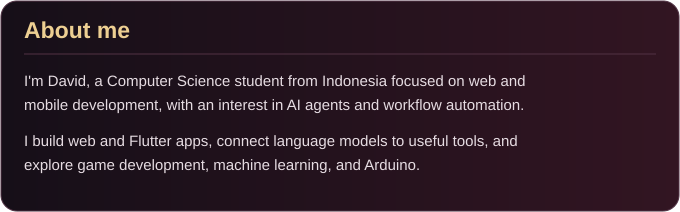
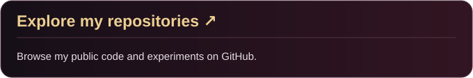
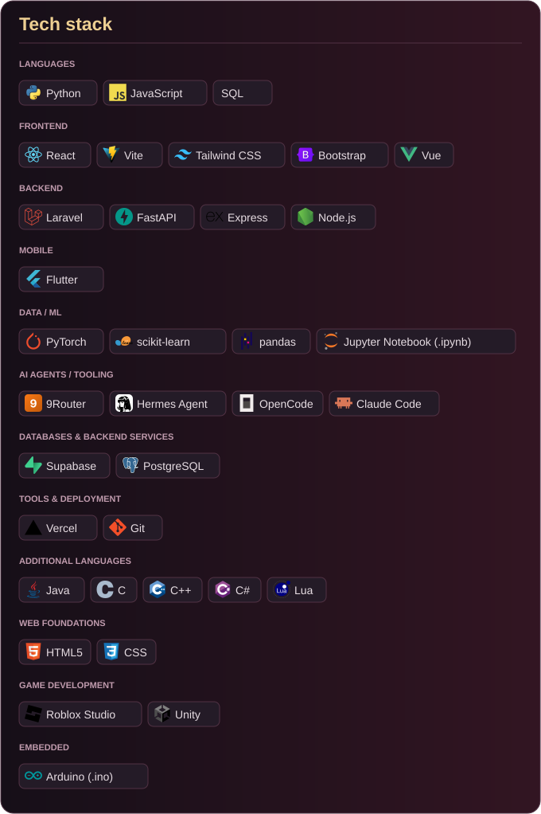
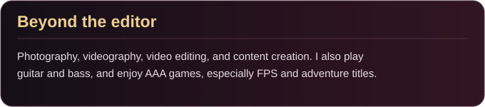

  

  
  

Data sources and update schedule

Updated daily from public GitHub data. Forks and this profile repository are excluded. Language percentages reflect source-code bytes, not coding time or proficiency; notebooks are included. The card shows the last successful refresh in UTC.

[Generator](./scripts/refresh_profile.py) · [Update history](https://github.com/VidVellichor/VidVellichor/actions/workflows/profile.yml)

---

<a href="#about-me">Back to top ↑</a>

