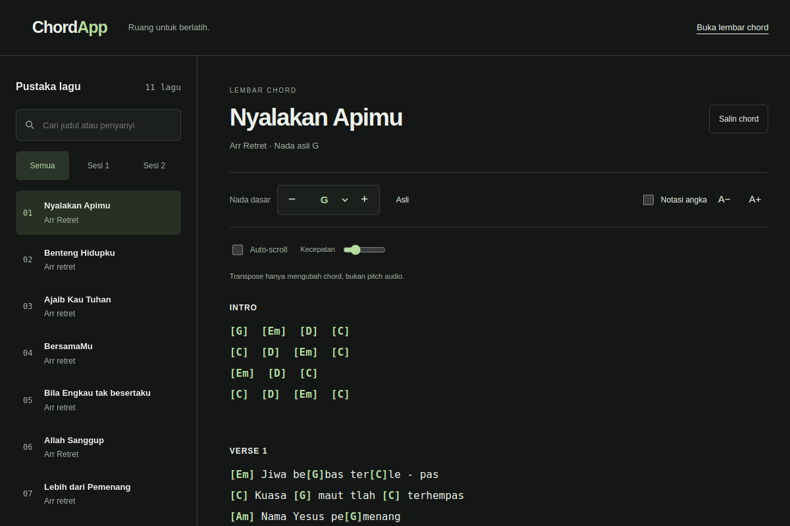
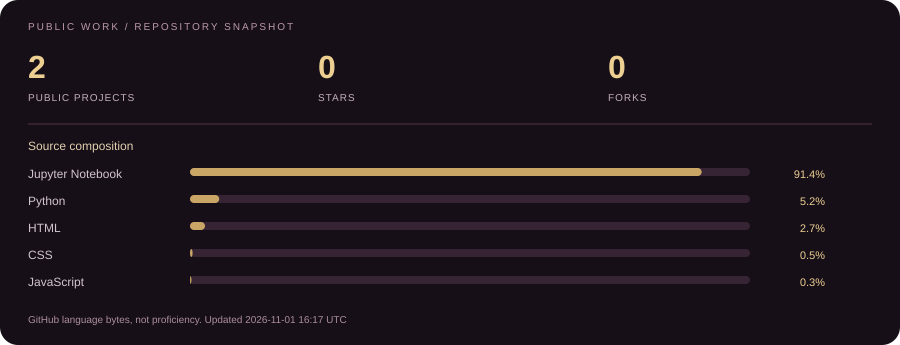

  

  
  

  <a href="#about-me">About</a> &nbsp; · &nbsp;
  <a href="#selected-projects">Projects</a> &nbsp; · &nbsp;
  <a href="#tech-stack">Stack</a> &nbsp; · &nbsp;
  <a href="#github-snapshot">GitHub</a> &nbsp; · &nbsp;
  <a href="https://linkedin.com/in/davidnehemia">LinkedIn ↗</a>

## About me

I'm David, a Computer Science student from Indonesia focused on web and mobile development, with an interest in AI agents and workflow automation.

I build web and Flutter apps, connect language models to useful tools, and explore game development, machine learning, and Arduino.

## Selected projects

### ChordApp

A chord-chart app for musicians who need to change keys without rewriting an arrangement. Scale-degree notation is resolved into chord names directly in the browser.

**JavaScript · HTML / CSS** · [Live demo ↗](https://chord-app-sand.vercel.app) · [Source code](https://github.com/VidVellichor/ChordApp)

### Signature Verification AI

A signature-comparison project using EfficientNet-B0 embeddings and cosine similarity, with a FastAPI backend and training notebooks.

**PyTorch · FastAPI · Jupyter** · [Source code and notebooks ↗](https://github.com/VidVellichor/signature-verification-ai)

## Tech stack

Tools I use and explore. Additional languages and other areas are listed below.

| Area | Technologies |
| :--- | :--- |
| **Languages** |  Python &nbsp;  JavaScript &nbsp; SQL |
| **Frontend** |  React &nbsp;  Vite &nbsp;  Tailwind CSS &nbsp;  Bootstrap &nbsp;  Vue |
| **Backend** |  Laravel &nbsp;  FastAPI &nbsp;  Express &nbsp;  Node.js |
| **Mobile** |  Flutter |
| **Data / ML** |  PyTorch &nbsp;  scikit-learn &nbsp;  pandas &nbsp;  Jupyter Notebook (.ipynb) |
| **AI agents / tooling** |  9Router &nbsp;  Hermes Agent &nbsp;  OpenCode &nbsp;  Claude Code |
| **Databases & backend services** |  Supabase &nbsp;  PostgreSQL |
| **Tools & deployment** |  Vercel &nbsp;  Git |

More languages, web foundations, game development and embedded

| Area | Technologies |
| :--- | :--- |
| **Languages (continued)** |  Java &nbsp;  C &nbsp;  C++ &nbsp;  C# &nbsp;  Lua |
| **Web foundations** |  HTML5 &nbsp;  CSS |
| **Game development** |  Roblox Studio &nbsp;  Unity |
| **Embedded** |  Arduino (.ino) |

## GitHub snapshot

Data sources and update schedule

Updated daily from public GitHub data. Forks and this profile repository are excluded. Language percentages reflect source-code bytes, not coding time or proficiency; notebooks are included. The card shows the last successful refresh in UTC.

[Generator](./scripts/refresh_profile.py) · [Update history](https://github.com/VidVellichor/VidVellichor/actions/workflows/profile.yml)

## Beyond the editor

Photography, videography, video editing, and content creation. I also play guitar and bass, and enjoy AAA games, especially FPS and adventure titles.

---

<a href="#about-me">Back to top ↑</a>

